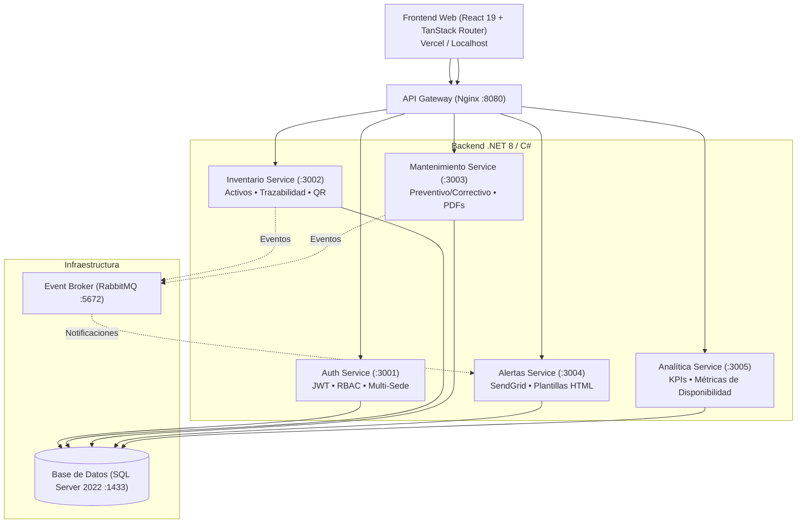

# CREO BioAsset - Sistema Inteligente de Gestión y Trazabilidad Hospitalaria

**CREO BioAsset** es una plataforma integral de grado clínico para la gestión del ciclo de vida, trazabilidad física/lógica, mantenimiento predictivo/correctivo, auditoría técnica e inventariado en tiempo real de equipamiento biomédico e infraestructura hospitalaria.

Desplegado en producción: **[https://creo-bioasset-one.vercel.app](https://creo-bioasset-one.vercel.app)**

---

## Arquitectura del Sistema

La solución está construida sobre una arquitectura desacoplada de microservicios con comunicación asíncrona basada en eventos:



### Componentes Principales:
* **Frontend (`/src`)**: Aplicación SPA moderna con React 19, TypeScript 5.8, Tailwind CSS v4, componentes accesibles basados en Radix UI / Shadcn, gráficos en Recharts y enrutador tipado con `@tanstack/react-router`.
* **API Gateway (`services/gateway`)**: Reverse Proxy Nginx en puerto `8080` que unifica el tráfico web y la resolución interna de servicios en Docker.
* **Auth Service (`services/auth-service`)**: Autenticación JWT, control de sesiones activas, roles administrativos (RBAC), tokens de recuperación y autorización granular multi-sede.
* **Inventario Service (`services/inventario-service`)**: Catálogo maestro de equipos biomédicos y tecnológicos (TI), ubicaciones físicas, estados operativos y generación de etiquetas QR con trazabilidad de movimientos.
* **Mantenimiento Service (`services/mantenimiento-service`)**: Programación de rondas de mantenimiento preventivo, gestión de incidencias correctivas y emisión de actas técnicas con adjuntos e imágenes.
* **Alertas Service (`services/alertas-service`)**: Monitor de vencimientos, notificaciones tempranas y envíos transaccionales unificados vía SendGrid.
* **Analítica Service (`services/analitica-service`)**: Consolidación de KPIs clínicos, MTBF, MTTR y disponibilidad de quirófanos y salas de cuidados críticos.

---

## Capacidades y Seguridad Implementada

### Seguridad y Control de Acceso (RBAC)
* **Tokens de Recuperación Efímeros**: Los enlaces de reseteo de contraseña utilizan tokens criptográficos únicos con vigencia estricta de **15 minutos**, firma HMAC-SHA256 e invalidación tras su primer uso.
* **Protección de Usuarios y Operaciones Críticas**: Restricción estricta (`[Authorize(Roles = "admin")]`) en endpoints de mutación de cuentas y protección contra auto-desactivación accidental.
* **Aislamiento Multi-Sede Estricto**: Políticas a nivel de servicio que impiden mutaciones (`POST`, `PUT`, `DELETE`) fuera de la jurisdicción física asignada a cada usuario.
* **Prevención de XSS y Manipulación DOM**: Sanitización de entidades HTML (`escapeHtml`) en el motor de generación e impresión de reportes hospitalarios.
* **Protección Anti-CSRF y Control de Sesión**: Interceptores HTTP con encabezados `X-Requested-With`, validación de tokens y expulsión controlada de sesiones expiradas.

### Experiencia de Usuario (UI/UX) y Diseño Responsivo
* **Menú Lateral Móvil Táctil**: Drawer de navegación con altura dinámica (`100dvh`), contenedor con scroll vertical suave (`overscroll-contain`) y pie de usuario con botón **"Cerrar sesión" siempre visible y anclado**.
* **Vista Adaptativa en Inventario**:
  * **Móvil (`< md`)**: Tarjetas responsivas de alta densidad que presentan código, badge de clase (BM/TI), estado operativo completo, ubicación, próximo mantenimiento con semáforo y botones de acción sin requerir scroll horizontal.
  * **Desktop / Tablet (`≥ md`)**: Tabla de control clínico con 6 columnas optimizadas.
* **Paginación Inteligente**: Controles elásticos adaptados a pantallas compactas (360px a 400px) que evitan desbordamientos en móviles.
* **Accesibilidad y Alto Contraste**: Paleta con soporte completo para modo claro y oscuro conforme a estándares WCAG (incluyendo badges amarillos de alto contraste en dark mode).

### Trazabilidad y Auditoría Técnica Hospitalaria
* **Pista de Auditoría en Ficha Técnica (QA-060)**: Registro automático en el historial de trazabilidad ante cualquier modificación de metadata (nombre, marca, modelo, serie, estado o ubicación), documentando usuario responsable, fecha/hora y diferencias exactas entre valor previo y nuevo.
* **Trazabilidad con Filtro de Ubicación Granular (QA-035)**: Filtro de movimientos con criterio de coincidencia por **Destino de llegada** (predeterminado), **Origen de salida** o **Ambas**.
* **Trazabilidad Automática ante Averías (QA-048 / QA-059)**: Al reportar avería o cambiar un equipo a *"Fuera de servicio"*, se asienta un movimiento de control clínico vinculado al reporte.
* **Sincronización Canónica de Mantenimientos (QA-050)**: Evaluación unificada de la próxima fecha según el último mantenimiento completado (`resultado === "Completado"`).

---

## Requisitos y Puesta en Marcha

### Prerrequisitos
* [Node.js](https://nodejs.org/) v20+ y `npm`
* [Docker Desktop](https://www.docker.com/) con Docker Compose activado

### 1. Clonar el Repositorio
```bash
git clone https://github.com/VictorRiveraT/CREO-Bioasset.git
cd CREO-Bioasset
```

### 2. Iniciar el Backend Completo (Docker)
En Windows puedes ejecutar el archivo por lotes automatizado:
```cmd
iniciar-servicios.bat
```
O directamente con Docker Compose:
```bash
docker-compose up -d --build
```

Esto levantará los 8 contenedores requeridos:
* Gateway (`:8080`)
* Auth Service (`:3001`)
* Inventario Service (`:3002`)
* Mantenimiento Service (`:3003`)
* Alertas Service (`:3004`)
* Analítica Service (`:3005`)
* RabbitMQ (`:5672` / UI: `:15672`)
* SQL Server 2022 (`:1433`)

### 3. Iniciar el Frontend (Desarrollo)
```bash
npm install
npm run dev
```

* **Acceso local completo**: Abre [http://localhost:8080](http://localhost:8080) (a través del Gateway).
* **Acceso Vite directo**: Abre [http://localhost:8081](http://localhost:8081).
* **Despliegue Productivo Cloud**: [https://creo-bioasset-one.vercel.app](https://creo-bioasset-one.vercel.app).

---

## Calidad de Código y Estándares

El proyecto cuenta con validación estricta de linters, formateo automatizado y cero tolerancia a errores de compilación:

| Comando | Función |
| :--- | :--- |
| `npm run lint` | Análisis estático con ESLint (Reglas de hooks, tipado estricto, 0 errores). |
| `npm run lint:fix` | Corrección automática de advertencias de linter. |
| `npm run format` | Formateo estricto de todo el proyecto con Prettier (`endOfLine: auto`). |
| `npm run build` | Compilación de TypeScript y empaquetado optimizado con Vite / Nitro. |

---

## Estructura de Directorios

```text
CREO-Bioasset/
├── .github/              # Flujos de integración y despliegue continuo (CI/CD)
├── postman/              # Colecciones de endpoints para pruebas de API
├── public/               # Recursos estáticos y manifiesto web
├── scripts/              # Scripts de inicialización y migración SQL (seed.sql)
├── services/             # Microservicios en .NET 8 y Nginx Gateway
│   ├── alertas-service/
│   ├── analitica-service/
│   ├── auth-service/
│   ├── gateway/
│   ├── inventario-service/
│   └── mantenimiento-service/
├── src/                  # Aplicación Frontend React 19
│   ├── components/       # Componentes visuales y sistema de diseño Shadcn/UI
│   ├── hooks/            # Custom hooks (mobile detection, media queries)
│   ├── lib/              # Estado global, cliente API REST, seguridad y exportador PDF
│   └── routes/           # Rutas tipadas organizadas con TanStack Router
├── docker-compose.yml    # Orquestación de contenedores e infraestructura
├── package.json          # Dependencias y scripts del frontend
└── README.md             # Documentación técnica general
```

---

_CREO BioAsset — Diseñado para operar con los más altos estándares de confiabilidad, seguridad y eficiencia clínica._
